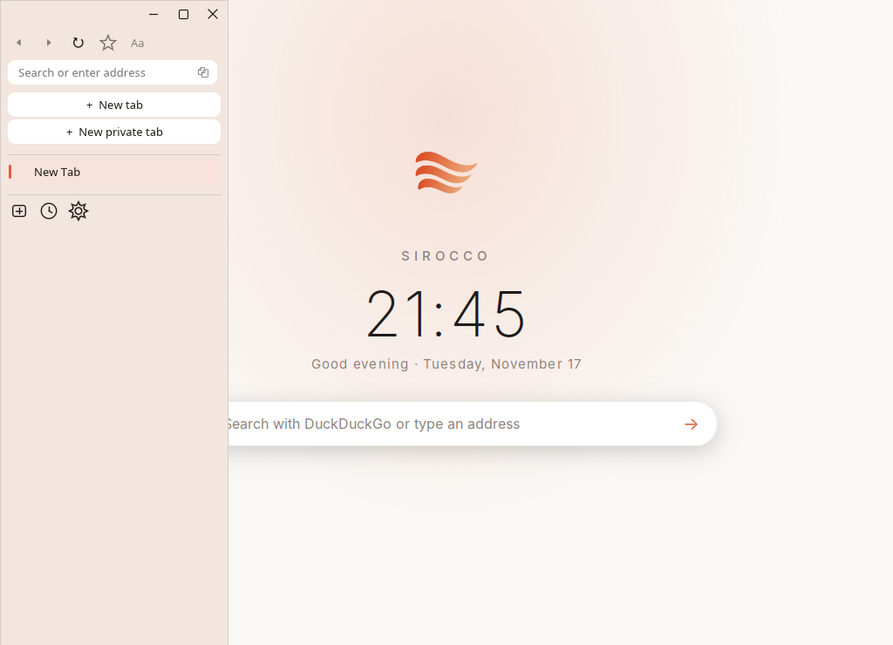
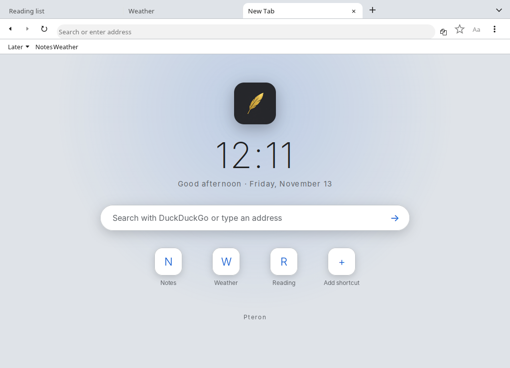
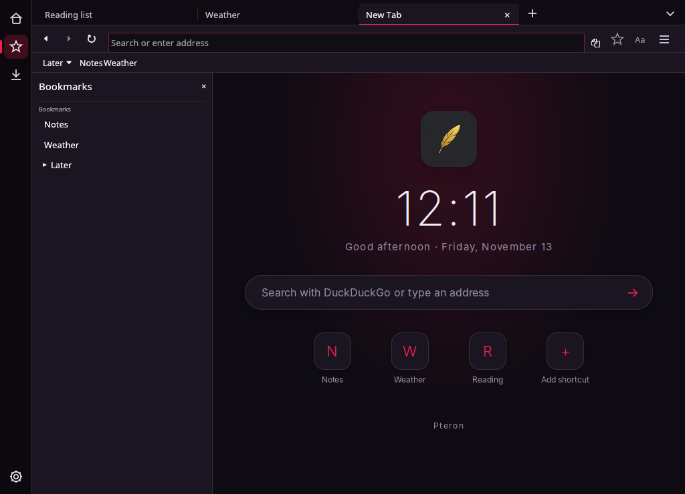
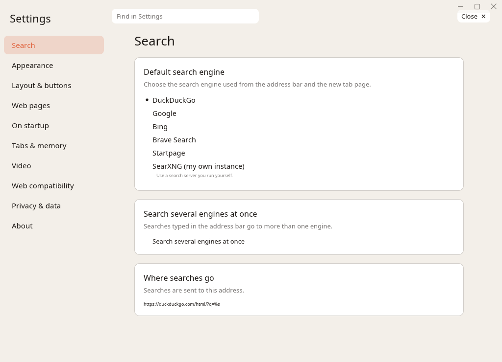
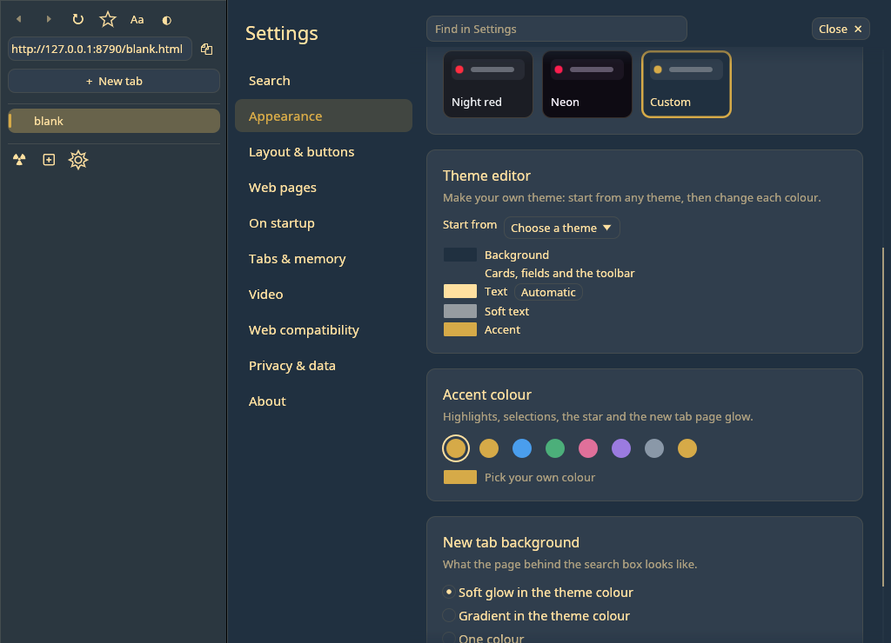
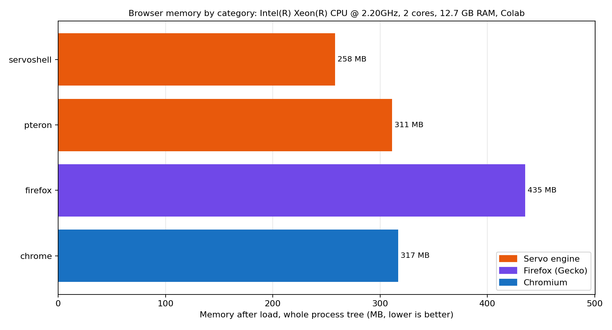

# Pteron

A light web browser for Windows and Linux, built on the [Servo](https://servo.org) engine (v0.7.0) in Rust.
Sidebar tabs, tabs that sleep to save memory, its own YouTube player and music app, a password
manager, an ad blocker, and a Memory saver mode for older computers.

Pteron is an early test version. Servo does not support every web feature yet, so some sites look
wrong or do not work (see [Known problems](#known-problems)). Read [Before you install](#before-you-install) first.



| Chrome-style layout | Opera GX-style layout |
|---|---|
|  |  |
| **Choosing a layout** | **Theme editor** |
|  |  |

## Features

**Browsing**
- Sidebar with tabs, pinned tabs, bookmarks (one folder level), history and downloads
- Tabs sleep after a while and wake when clicked; session restore brings tabs back asleep
- **Split view**: right-click a tab, **Show beside the current tab**; drag the bar between the two pages
  (double-click it to share the space evenly). Both pages stay awake while they are on screen
- Right-click menu on tabs: reload, duplicate, **Mute tab**, **Take screenshot** (a PNG in your Pictures
  folder), pin, **Keep awake** (the tab never goes to sleep, for a page that must stay connected), split view,
  open in the default browser, close other tabs or the ones after it
- In split view a compatibility tab shows its page in either half (before, only while it was the active tab)
- A tab playing sound shows a speaker; click it to mute the tab (and again to unmute)
- **History** (Ctrl+H, or the clock button): every page you visited, by day, with search and a remove button
  per page
- The reload button turns into a stop button while a page loads
- Find in page, reading mode (the **Aa** button), popup blocking
- Address bar shortcuts: `g`, `ddg`, `yt`, `w`, `gh`, `maps`, `r`, and `i` for pictures
  (for example `yt lofi`, `i red car`)
- Themes, accent colours and a custom new tab page (background, tiles)
- Your own shortcuts on the new tab page (add with **+**, remove with **×**)
- Search engines: DuckDuckGo, Google, Bing, Brave, Startpage or your own SearXNG; optionally
  search several engines at once (one tab per engine, or one merged results page)

**Make it yours**
- Settings, **Layout & buttons**: Pteron's sidebar, or tabs on top in the style of Chrome, Firefox, Opera or
  Opera GX (the Opera styles add a bar of shortcuts down the left side); each comes with matching colours
- Pteron draws its own window top: the tabs (or the sidebar) hold the minimize, maximize and close
  buttons, drag empty space to move the window, the edges resize it; the system title bar is a setting away
- Sidebar on the left or right and as wide as you like; interface size (75 to 175%), compact or roomy spacing,
  corner roundness; choose which buttons show; site icons and close buttons on tabs; a bookmarks bar
- Settings, Appearance, **Theme editor**: start from any theme and change every colour
- Settings, **Web pages**: dark mode for sites (pages with their own dark look use it, other light pages are
  turned dark, with a switch per site) and your own CSS for any site

**Plume (YouTube) and Plume Music**
- YouTube search, channels and videos open in simple Pteron pages with a built-in player (up to
  1080p60, H.264), because Servo has no Media Source Extensions yet
- Videos start faster (the first 30 seconds play while the rest loads; "Up next" loads after the player
  shows; recent videos are remembered for 30 minutes)
- **Subscriptions without an account**: subscribe on a video or channel, and the home page shows their newest
  videos (from YouTube's public feeds); import a Google Takeout CSV or an OPML file, export both
- **Chapters**: times in a description are links, and chapters show as marks on the seek bar with their
  name when you point at it
- **Subtitles**: YouTube's captions (also automatic ones) drawn over the video, in full screen too; the
  language you pick is remembered; press **C** to switch them on or off
- **Loop**, **Autoplay next**, and **Audio only** in the quality list
- **SponsorBlock** (off by default; Settings, Video): sponsor segments, self-promotion and subscribe
  reminders are skipped, with an Undo button, and shown on the seek bar
- Plume Music for listening, with queues, playlists and liked songs
- Plume Music **Radio** (when the queue ends, songs like the last one keep playing), a **sleep timer**
  (15, 30 or 60 minutes, fading out), and **time-synced lyrics** from lrclib.net (off by default)
- Download videos as .mp4 and songs as .mp3 (converted inside Pteron, with the video's picture as the
  cover of the MP3)

**Privacy and security**
- Ad and tracker blocking: a built-in list of well-known networks, plus optional full EasyList and EasyPrivacy lists (uses 15 to 30 MB more memory)
- Tracking parts (`utm_*`, `fbclid`, `gclid`, ...) removed from links
- Do Not Track and Global Privacy Control signals (after a restart)
- https first: plain http sites are checked for an https version; otherwise a warning page appears
- Saved passwords on ordinary login forms, encrypted (Windows: with your Windows account; Linux: AES-256-GCM
  under a key in your system keyring, or in a key file only your account can read), kept only on this
  computer, never synced and never included in problem reports
- Clear history and cache on exit (optional); sync never carries security switches
- Updates must carry a SHA-256 file and a signature from the author's key, or they are refused

**Low memory**
- Settings, Tabs, **Memory saver**: Normal, Low memory and Lowest memory levels trade speed for
  less RAM (smaller video buffer, earlier tab sleep, fewer helper threads, smaller cache)
- Closed and sleeping tabs give their memory back: Pteron asks the engine to clean up after a tab goes away, and the
  engine hands freed memory back to the system instead of keeping it
- Each tab keeps only its last 2 pages ready for Back (1 with Memory saver); older pages reload when you go back
- Animations and smooth scrolling run at 60 frames a second (the engine drew 120, which most screens cannot show),
  30 with Lowest memory
- While the window is minimized (or completely covered, on Linux), the visible page slows down like a background
  tab: timers run once a second and animations pause; a page playing sound or video is left alone
- The in-memory web cache keeps at most 2000 responses (the engine kept 5000, whatever their size)
- When the computer runs short of memory, background tabs go to sleep early, the longest-unused first; Low memory
  keeps at most 8 background tabs awake and Lowest memory 4
- A tab that wakes up goes back to where you had scrolled
- Pages in background tabs and in a minimized window have their script memory shrunk (caches and compiled code that
  can be rebuilt are dropped)
- The fonts for Chinese, Japanese and Korean text in the sidebar (tens of MB) are loaded only when such text appears
- Settings shows Pteron's memory and, separately, what open compatibility tabs add
- A memory log is written next to the crash log
- Typical use on the author's computers: around 100 to 140 MB with a blank tab, more with
  YouTube open. Measure on your own PC; the numbers depend on the machine

**Web compatibility**
- Settings, **Web compatibility**: switch on newer web features one by one (IndexedDB, observers,
  fonts, canvas, storage, container queries). They are off by default because they can make
  some sites worse
- After a crash, Pteron starts in safe mode with those features off
- **Check this page** (tab context menu) writes a small report about what a page is missing

**Compatibility tab**
- Pages that Servo cannot handle (Cloudflare's browser check and similar) open in your system's own web engine (WebView2 on Windows, WebKitGTK on Linux) inside a normal tab, by themselves, after asking, or never (Settings, Tabs)
- Sites you choose, or that switched by themselves, open there from the start; the list is in Settings
- Experimental: after a site's browser check passes, Pteron can copy the pass cookie to its own engine and close the system engine, so the heavy engine only runs for a few seconds (off by default; if the site does not accept it, the page goes back to a compatibility tab)
- The engine is started only for such a tab, uses less memory when the tab is hidden, and is closed after a while; it keeps its own sign-ins and does not use the ad blocker or saved passwords

**Other**
- Sync of bookmarks and settings through a folder you choose
- Self-update from Settings, About
- Crash log and problem report file

## Benchmarks

Memory of the whole browser (every process, private memory only) on a shared cloud machine, measured by the notebook in
[`benchmarks/`](benchmarks/). All numbers are from one run of that notebook; the raw data is in
[`benchmarks/results.csv`](benchmarks/results.csv).

**Test machine:** Google Colab, Intel Xeon @ 2.20 GHz, 2 cores, 12.7 GB RAM, Ubuntu 24.04, no GPU (virtual screen, software
rendering), 7 November 2026. Pteron is build 62 (Linux); servoshell is the official Servo v0.7.0 program; Firefox 159, Chrome 157.



**One page open** (median of 3 runs over 9 pages, 20 s after the page loaded)

| Category | Browser | Memory | vs Chrome |
|---|---|---|---|
| Servo engine | servoshell (plain Servo) | 258 MB | 0.81x |
| Servo engine | **Pteron** | **311 MB** | **0.98x** |
| Chromium | Chrome | 317 MB | 1.00x |
| Firefox (Gecko) | Firefox | 435 MB | 1.37x |

**Ten tabs open** (one run; the second column is 7 minutes later, after Pteron's tabs had time to sleep)

| Category | Browser | After 1 min | After 7 min |
|---|---|---|---|
| Chromium | Chrome | 571 MB | 586 MB |
| Firefox (Gecko) | Firefox | 888 MB | 788 MB |
| Servo engine | **Pteron** | 1298 MB | **946 MB** |
| Servo engine | servoshell (plain Servo) | 1241 MB | 1241 MB |

What this says, and what it does not:
- With one page open Pteron uses about as much memory as Chrome and clearly less than Firefox. Plain Servo is lowest; Pteron's own
  sidebar and features add about 50 MB.
- With many tabs Pteron is heavier than Chrome and Firefox. Sleeping tabs cut it by about a quarter after a few minutes; plain
  Servo has no such feature. Cutting the per-tab cost is the next job.
- Memory is counted as private memory per process (USS). Chrome and Firefox share some memory between their processes, so
  their numbers look slightly better than their real footprint; Servo runs as one process, so its number is exact.
- The machine has no GPU, so Pteron's interface is drawn in software here. The ten-tab test is a single run. Numbers from other
  machines will differ; compare browsers within one run only. Windows numbers are still to come.

To repeat it, open [`benchmarks/servo_benchmark.ipynb`](benchmarks/servo_benchmark.ipynb) in Google Colab (Runtime, Run all) or
Kaggle (turn Internet on), or run it in Ubuntu 24.04 or WSL2. It downloads the browsers, measures them, and writes `report.md`,
`results.csv` and the chart.

## Installing and updating

Releases are published on the [Releases page](https://github.com/Sm0r3s-source/pteron/releases)
as `Pteron-Setup.exe` and a zip for Windows, and `Pteron-build-N-linux64.tar.gz` for Linux (unpack it and run `./install.sh`; it installs for your user only, no root). Pteron updates itself from **Settings, About**; nothing is
installed without your say-so. Windows may warn about the installer because it is not signed yet.

## Before you install

Things that carry some risk, said plainly:

- **The installer is not code-signed.** Windows warns about it, and nothing but GitHub's own download link vouches
  for the first copy you install; the `.sha256` file next to it only catches a broken download. From then on, Pteron
  installs an update only if its SHA-256 is signed with the author's key, which is built into Pteron.
- **Saved passwords** are encrypted. On Windows with Windows' own protection (DPAPI), tied to your Windows account,
  in `%APPDATA%\Pteron\passwords.json`. On Linux with AES-256-GCM, under a random key kept in your system keyring
  (GNOME Keyring or KWallet, through `secret-tool`); with no keyring, the key is in `~/.config/Pteron/passwords.key`,
  which only your account can read (weaker: anyone who copies both files has the passwords). That stops someone who
  copies the password file to another computer or signs in as another user. It does not stop a program running under
  your account, or a person at your unlocked PC: there is no master password. Passwords are filled only after a click, are never synced and never put in problem reports.
- **The compatibility tab** shows a page in your system's web engine (WebView2 or WebKitGTK) with its own cookies;
  Pteron's ad blocker and saved passwords do not apply there.
- **Handing a browser check over (experimental, off by default):** after the system engine passes a site's browser
  check, Pteron copies that site's cookies, including the pass, into its own engine, and from then on tells every
  site it is the system engine's browser, until you switch the option off. The site then talks to a different engine
  than the one it checked. Sites may refuse it or see it as getting around their check; leave it off unless you
  need it.
- **Plume** talks to YouTube through the interface YouTube's own apps use, not an official public API. It can stop
  working whenever YouTube changes something, and saving videos or songs may be against YouTube's terms or the law
  where you live. That is yours to judge.
- **It is one person's test software** on an engine that is still young: no private window and no extensions.
  Do not make it the only browser you rely on for banking or work.

## Security

Build 67 was a security pass over Pteron's own code. What was found and fixed:

- **Web pages could read Pteron's internal pages.** A plain http page, or a sandboxed frame inside one, could fetch
  `servo:newtab` and read your shortcuts, bookmarks and most visited sites. Internal pages now only load as a
  page you open yourself; web pages can neither fetch them nor show them in a frame.
- **The bad-certificate page could be used to trust any certificate.** Servo's page offered "allow this
  certificate" and carried a secret that the failing site's own scripts could read. That button and the secret
  are gone; a site with a bad certificate now gets an error page with a Go back button.
- **Frames could fake password prompts.** The password helper's messages are now marked with a code that changes
  every run, and saved passwords are only filled into the top page of the exact site they were saved for, over
  https (or http on your own computer).
- **Permission prompts** (location, camera, microphone, notifications) now name the site asking.
- **Full screen:** when a page goes full screen, Pteron says which site did it and that Esc leaves.
- **JavaScript engine** updated to SpiderMonkey 153.6 (from 153.3), which carries Mozilla's security fixes
  for those versions.
- **Linux: temporary files** (updates and video pieces) were kept in the shared `/tmp` folder, where another
  user of the same computer could swap them before Pteron used them. They now go to `~/.cache/Pteron/tmp`,
  which only you can open.
- **Downloads:** many more file types that can run code now need the extra confirmation (`.js`, `.iso`,
  `.chm`, `.cpl`, `.url` and others), and file names can no longer hide their real type with text-flipping
  characters (`photo‮gpj.exe` shown as `photoexe.jpg`).
- **Compatibility tab:** the system engine's own check for harmful sites and downloads (SmartScreen) was
  switched off to save memory; it is on again. Pop-ups there open only web addresses.
- **Off for good:** two experimental engine features that never ask first, reading the clipboard
  (`navigator.clipboard.readText`) and taking over `mailto:` links, stay off even with "Experimental web
  features" on.
- **Smaller things:** random codes come from the system's secure random source; the "Check this page"
  report can no longer be faked by a page; new tab tiles only link to web addresses.
- **Fake pages in the address:** a web page can no longer send you to a `data:` address (a whole fake
  sign-in page packed into the address) or to a file on your computer.
- **Dialogs:** alert, confirm and prompt boxes say which site they come from, frames from another site
  can no longer open them over the page (as the web standard says), and from a page's second box on you
  can stop it opening more. The sign-in box shows look-alike addresses in their real `xn--` form.
- **Address bar:** a pasted `javascript:` address is searched for instead of run in the open page (the
  "paste this to get free ..." trick).
- **Downloads:** one click can start at most three downloads in ten seconds.
- **Linux:** Pteron's folders (settings, history, cookies) are now readable only by you.
- **SameSite cookies:** Servo sent every cookie with every request, so the usual defence against
  cross-site request forgery (`SameSite=Lax` and `Strict` cookies) did nothing: another site could
  submit a form to your bank with you signed in. Pteron now follows `SameSite`; cookies without it work
  as before, as in Firefox and Safari.
- **Your home network:** a site on the internet can no longer make Pteron send requests into your
  computer or home network (your router at 192.168.1.1, a printer, programs listening on `localhost`).
  Pages on your own network are not limited.
- **Timers:** page timers are now 100 microseconds coarse (was 10), as in Chrome and Firefox for most
  pages. Pteron runs every site in one process, so precise timers would make Spectre-style attacks easier.
- **Pages can no longer** move or resize the Pteron window, or open a file chooser without a click.
- **Programs over http:** program files are only downloaded over https (or from your own network).
- **Blocked frames:** a frame blocked by the ad blocker or the rules above left the page "loading"
  forever; it now gets an empty page.

- **Libraries:** a check of all Rust libraries against the RustSec advisory database found 16 known holes;
  15 are fixed by newer versions (among them rustls and webpki, which handle every https connection,
  zstd and rsa). The one left (SQLite inside the cache library) needs crafted files placed in your own
  profile folder. GitHub now runs this check on every push and once a week.
- **Dangerous sites:** Pteron warns before known phishing and malware sites and loads nothing from them
  (free lists from the malware-filter project: URLhaus, PhishTank, OpenPhish and others; refreshed weekly
  and checked on your computer, so the sites you visit are not sent anywhere). On by default.
- **DNS rebinding:** a site name that pointed to the internet is not allowed to switch to an address in
  your home network (the trick that gets around the home network block above). WebSockets get the same
  checks.
- **Windows Hello before filling passwords** (Settings, Passwords, off by default): Windows asks for your
  PIN, fingerprint or face before a saved password is filled; one confirmation counts for five minutes.

**Block third-party cookies** (Settings, Privacy & data, off by default) sends no cookies with requests
that other sites cause (frames, pictures and scripts embedded from elsewhere).

**Strict security** (Settings, Privacy & data, off by default) runs JavaScript without its speed-up
compiler (JIT), where most attacks on browser engines happen, like Edge's strict mode. Heavy scripts get
slower and WebAssembly stops working.

Checked and already fine: Pteron's local video helper only answers addresses with a secret code; local
files opened in Pteron cannot read other files; pop-ups need a click; updates need a SHA-256 signed with the author's key and never go back to an older build;
downloads get Windows' "came from the internet" mark, dangerous file types are blocked and every download is
confirmed; bookmark import drops `javascript:` links; developer tools are off unless Pteron is started with
`--devtools`.

What is not fixed, said plainly:

- **No process sandbox.** Pages run inside Pteron's own process, not in locked-down child processes as in Chrome or
  Firefox. A bug in the engine that a page can exploit reaches everything Pteron can reach.
- **The installer is not code-signed** (see above). Signing with Azure Artifact Signing is prepared and
  switches on once an account is set up.
- **Revoked certificates are not checked**, and Windows video still uses Servo's GStreamer 1.22.8 (2023);
  moving to GStreamer 1.28 is planned.

Found a security problem? Please report it privately, as [SECURITY.md](SECURITY.md) explains.

## Building

Pteron is a set of files laid over a Servo v0.7.0 checkout, kept here at the same paths they have in Servo.
[BUILD.md](BUILD.md) has the steps; in short:

```
git clone https://github.com/Sm0r3s-source/pteron.git
bash pteron/pteron_build/from_repo.sh                                              # Linux or WSL2
powershell -ExecutionPolicy Bypass -File .\pteron\pteron_build\from_repo.ps1       # Windows
```

The scripts fetch Servo v0.7.0, copy Pteron's files over it and build. On Linux the compatibility tab uses WebKitGTK
(`libwebkit2gtk-4.1`, `libgtk-3`) and Pteron runs in X11 mode (X11/XWayland) for now. The unit tests of Pteron's own
modules run on every push (`.github/workflows/pteron-tests.yml`, `pteron_ci/`); a full Servo build in CI is planned.

## Where things are

New files are in `ports/servoshell/`. Some of the main ones:

| File | What it does |
|---|---|
| `desktop/sidebar.rs`, `desktop/settings_page.rs` | The sidebar and the Settings page (egui) |
| `youtube.rs`, `innertube.rs`, `streamproxy.rs`, `mp4mux.rs` | Plume: YouTube pages, API, local video helper, MP4 muxer |
| `plume.rs` | Plume extras: up next, subscriptions and feeds, chapters, subtitles, SponsorBlock |
| `music.rs`, `downloads.rs`, `mp3.rs` | Plume Music, downloads, MP3 conversion |
| `adblock.rs`, `privacy.rs`, `secure.rs`, `passwords.rs` | Blocking, tracking removal, https, passwords |
| `sync.rs`, `updater.rs`, `library.rs` | Sync, self-update, bookmarks and history |
| `compat.rs`, `sitecheck.rs`, `crashlog.rs`, `report.rs` | Compatibility, page check, crash and problem reports |
| `compat_view.rs`, `compat_host.rs` | Compatibility tab: when to switch, and the embedded system web engine |
| `memsaver.rs`, `multisearch.rs`, `util.rs`, `locks.rs` | Memory saver, multi-engine search, shared helpers |

Pteron also makes small changes in Servo's own files (`components/config/prefs.rs`,
`components/net/http_loader.rs`, `components/servo/servo.rs`, the GStreamer media backend, the
media element's `timeupdate` events (`components/script/dom/html/embedded_content/htmlmediaelement.rs`: they never fired for a video whose page had not asked for `textTracks`), the media controls (`components/script/resources/media-controls.js` and `.css`: chapter and segment marks on the
seek bar, and the chapter name when you point at it), the memory allocator in `components/allocator/`, a "collect garbage" message in
`components/constellation/` and `components/shared/constellation/`, the animation frame rate in
`components/paint/refresh_driver.rs`, the garbage collection of background pages in
`components/script/event_loop/script_thread.rs`, placing a page in part of the window for split view in
`components/paint/` and `components/servo/webview.rs`, the newer JavaScript engine in `Cargo.toml`, the
bad-certificate page in `components/default-resources/`, and blocking dialogs from frames of other sites in
`components/script/dom/window/window.rs`, SameSite cookies and third-party cookie blocking in
`components/net/http_loader.rs`, coarser timers in `components/script/dom/performance/`, and file
choosers only after a click in `components/script/dom/html/form_controls/htmlinputelement.rs`, the DNS
rebinding guard in `components/net/connector.rs` and `components/net/websocket_loader.rs`, and the move to
the fixed `rsa` 0.10 in `components/script/dom/webcrypto/subtlecrypto/rsa_common.rs`). They are
published here under
the MPL-2.0, like the rest of Servo.

## Known problems

- Protected (DRM) media does not work: Spotify, Netflix, Disney+ and similar
- Strict anti-bot checks, including Cloudflare's "Just a moment" page, cannot be passed by Pteron's own engine; Pteron opens those pages in a compatibility tab instead (see above)
- Some modern pages look wrong, stay blank or load slowly; the engine does not support every web feature
- Windows and Linux (the Linux build is new and runs in X11 mode); macOS comes later; no extensions and no private window
- Muting a tab mutes its audio and video elements; sound from the Web Audio API keeps playing
- Videos play H.264 up to 1080p60; VP9, AV1 and 4K are not supported

The same list, kept up to date, is in the browser at `servo:known-issues`.

## Reporting problems

Open the sidebar, then **Settings, About, Report a problem**. It saves a small file on your
Desktop with the details (no passwords). Attach it to an issue.

## License

Pteron is released under the [Mozilla Public License 2.0](LICENSE), the same as Servo. The files under
`components/`, `python/` and `resources/` are Servo's own files with Pteron's changes; Servo is the work of the
[Servo project](https://servo.org) contributors.
