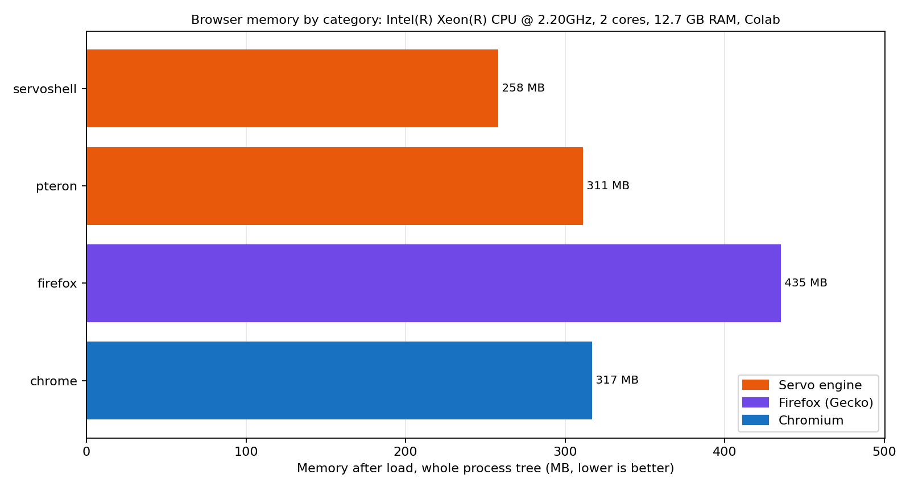

# Pteron

A light web browser for Windows and Linux, built on the [Servo](https://servo.org) engine (v0.7.0) in Rust.
Sidebar tabs, tabs that sleep to save memory, its own YouTube player and music app, a password
manager, an ad blocker, and a Memory saver mode for older computers.

Pteron is an early test version. Servo does not support every web feature yet, so some sites look
wrong or do not work (see [Known problems](#known-problems)).

## Features

**Browsing**
- Sidebar with tabs, pinned tabs, bookmarks (one folder level), history and downloads
- Tabs sleep after a while and wake when clicked; session restore brings tabs back asleep
- Find in page, reading mode (the **Aa** button), popup blocking
- Address bar shortcuts: `g`, `ddg`, `yt`, `w`, `gh`, `maps`, `r`, and `i` for pictures
  (for example `yt lofi`, `i red car`)
- Themes, accent colours and a custom new tab page (background, tiles)
- Search engines: DuckDuckGo, Google, Bing, Brave, Startpage or your own SearXNG; optionally
  search several engines at once (one tab per engine, or one merged results page)

**Plume (YouTube) and Plume Music**
- YouTube search, channels and videos open in simple Pteron pages with a built-in player (up to
  1080p60, H.264), because Servo has no Media Source Extensions yet
- Plume Music for listening, with queues, playlists and liked songs
- Download videos as .mp4 and songs as .mp3 (converted inside Pteron)

**Privacy and security**
- Ad and tracker blocking: a built-in list of well-known networks, plus optional full EasyList and EasyPrivacy lists (uses 15 to 30 MB more memory)
- Tracking parts (`utm_*`, `fbclid`, `gclid`, ...) removed from links
- Do Not Track and Global Privacy Control signals (after a restart)
- https first: plain http sites are checked for an https version; otherwise a warning page appears
- Saved passwords on ordinary login forms, locked with your Windows account, kept only on this
  computer, never synced and never included in problem reports
- Clear history and cache on exit (optional); sync never carries security switches
- Updates must carry a SHA-256 file and a signature from the author's key, or they are refused

**Low memory**
- Settings, Tabs, **Memory saver**: Normal, Low memory and Lowest memory levels trade speed for
  less RAM (smaller video buffer, earlier tab sleep, fewer helper threads, smaller cache)
- Closed and sleeping tabs give their memory back: Pteron asks the engine to clean up after a tab goes away, and the
  engine hands freed memory back to the system instead of keeping it
- Each tab keeps only its last 2 pages ready for Back (1 with Memory saver); older pages reload when you go back
- Animations and smooth scrolling run at 60 frames a second (the engine drew 120, which most screens cannot show),
  30 with Lowest memory
- While the window is minimized (or completely covered, on Linux), the visible page slows down like a background
  tab: timers run once a second and animations pause; a page playing sound or video is left alone
- The in-memory web cache keeps at most 2000 responses (the engine kept 5000, whatever their size)
- When the computer runs short of memory, background tabs go to sleep early, the longest-unused first; Low memory
  keeps at most 8 background tabs awake and Lowest memory 4
- A tab that wakes up goes back to where you had scrolled
- Pages in background tabs and in a minimized window have their script memory shrunk (caches and compiled code that
  can be rebuilt are dropped)
- The fonts for Chinese, Japanese and Korean text in the sidebar (tens of MB) are loaded only when such text appears
- Settings shows Pteron's memory and, separately, what open compatibility tabs add
- A memory log is written next to the crash log
- Typical use on the author's computers: around 100 to 140 MB with a blank tab, more with
  YouTube open. Measure on your own PC; the numbers depend on the machine

**Web compatibility**
- Settings, **Web compatibility**: switch on newer web features one by one (IndexedDB, observers,
  fonts, canvas, storage, container queries). They are off by default because they can make
  some sites worse
- After a crash, Pteron starts in safe mode with those features off
- **Check this page** (tab context menu) writes a small report about what a page is missing

**Compatibility tab**
- Pages that Servo cannot handle (Cloudflare's browser check and similar) open in your system's own web engine (WebView2 on Windows) inside a normal tab, by themselves, after asking, or never (Settings, Tabs)
- Sites you choose, or that switched by themselves, open there from the start; the list is in Settings
- Experimental: after a site's browser check passes, Pteron can copy the pass cookie to its own engine and close the system engine, so the heavy engine only runs for a few seconds (off by default; if the site does not accept it, the page goes back to a compatibility tab)
- The engine is started only for such a tab, uses less memory when the tab is hidden, and is closed after a while; it keeps its own sign-ins and does not use the ad blocker or saved passwords

**Other**
- Sync of bookmarks and settings through a folder you choose
- Self-update from Settings, About
- Crash log and problem report file

## Benchmarks

Memory of the whole browser (every process, private memory only) on a shared cloud machine, measured by the notebook in
[`benchmarks/`](benchmarks/). All numbers are from one run of that notebook; the raw data is in
[`benchmarks/results.csv`](benchmarks/results.csv).

**Test machine:** Google Colab, Intel Xeon @ 2.20 GHz, 2 cores, 12.7 GB RAM, Ubuntu 24.04, no GPU (virtual screen, software
rendering), 7 November 2026. Pteron is build 62 (Linux); servoshell is the official Servo v0.7.0 program; Firefox 159, Chrome 157.



**One page open** (median of 3 runs over 9 pages, 20 s after the page loaded)

| Category | Browser | Memory | vs Chrome |
|---|---|---|---|
| Servo engine | servoshell (plain Servo) | 258 MB | 0.81x |
| Servo engine | **Pteron** | **311 MB** | **0.98x** |
| Chromium | Chrome | 317 MB | 1.00x |
| Firefox (Gecko) | Firefox | 435 MB | 1.37x |

**Ten tabs open** (one run; the second column is 7 minutes later, after Pteron's tabs had time to sleep)

| Category | Browser | After 1 min | After 7 min |
|---|---|---|---|
| Chromium | Chrome | 571 MB | 586 MB |
| Firefox (Gecko) | Firefox | 888 MB | 788 MB |
| Servo engine | **Pteron** | 1298 MB | **946 MB** |
| Servo engine | servoshell (plain Servo) | 1241 MB | 1241 MB |

What this says, and what it does not:
- With one page open Pteron uses about as much memory as Chrome and clearly less than Firefox. Plain Servo is lowest; Pteron's own
  sidebar and features add about 50 MB.
- With many tabs Pteron is heavier than Chrome and Firefox. Sleeping tabs cut it by about a quarter after a few minutes; plain
  Servo has no such feature. Cutting the per-tab cost is the next job.
- Memory is counted as private memory per process (USS). Chrome and Firefox share some memory between their processes, so
  their numbers look slightly better than their real footprint; Servo runs as one process, so its number is exact.
- The machine has no GPU, so Pteron's interface is drawn in software here. The ten-tab test is a single run. Numbers from other
  machines will differ; compare browsers within one run only. Windows numbers are still to come.

To repeat it, open [`benchmarks/servo_benchmark.ipynb`](benchmarks/servo_benchmark.ipynb) in Google Colab (Runtime, Run all) or
Kaggle (turn Internet on), or run it in Ubuntu 24.04 or WSL2. It downloads the browsers, measures them, and writes `report.md`,
`results.csv` and the chart.

## Installing and updating

Releases are published on the [Releases page](https://github.com/Sm0r3s-source/pteron/releases)
as `Pteron-Setup.exe` and a zip for Windows, and `Pteron-build-N-linux64.tar.gz` for Linux (unpack it and run `./install.sh`; it installs for your user only, no root). Pteron updates itself from **Settings, About**; nothing is
installed without your say-so. Windows may warn about the installer because it is not signed yet.

## Building

Pteron is a set of changes on top of a Servo v0.7.0 checkout, not a fork with its own history.
The update scripts copy the changed files into the checkout and build it.

You need a normal Servo build setup on Windows:
- Rust (the toolchain Servo pins)
- Visual Studio Build Tools with the "Desktop development with C++" workload
- LLVM (`winget install LLVM.LLVM`), so that `lld-link.exe` is on your PATH
- The other prerequisites listed in the [Servo book](https://book.servo.org)

Then, from the folder with an update:

```
powershell -ExecutionPolicy Bypass -File .\pteron_updateNN.ps1 -Publish
```

`-NoBuild` copies the files without building; `-Publish` builds, packages and publishes a release;
`-Production` builds like the official Servo releases (link-time optimisation, optimised for size), which gives a
smaller, faster Pteron that uses less memory but takes an hour or more to build and needs about 16 GB of memory.
The unit tests of Pteron's own modules run on every push (`.github/workflows/pteron-tests.yml`, `pteron_ci/`); a fully
reproducible Servo build in CI is planned.

### Linux

The Linux build is new (update 62) and is built from the same source. In Linux or WSL2, put `pteron_update62.zip` and
`pteron_build_linux.sh` in one folder and run `bash pteron_build_linux.sh` (about 25 GB of disk, 8 GB of memory). The
compatibility tab on Linux uses WebKitGTK (`libwebkit2gtk-4.1`, `libgtk-3`) and is built in with `--features compat_linux`; it runs
in X11 mode (Pteron uses X11/XWayland on Linux for now). Saved passwords are Windows only for now. macOS comes later.

## Where things are

New files are in `ports/servoshell/`. Some of the main ones:

| File | What it does |
|---|---|
| `desktop/sidebar.rs`, `desktop/settings_page.rs` | The sidebar and the Settings page (egui) |
| `youtube.rs`, `innertube.rs`, `streamproxy.rs`, `mp4mux.rs` | Plume: YouTube pages, API, local video helper, MP4 muxer |
| `music.rs`, `downloads.rs`, `mp3.rs` | Plume Music, downloads, MP3 conversion |
| `adblock.rs`, `privacy.rs`, `secure.rs`, `passwords.rs` | Blocking, tracking removal, https, passwords |
| `sync.rs`, `updater.rs`, `library.rs` | Sync, self-update, bookmarks and history |
| `compat.rs`, `sitecheck.rs`, `crashlog.rs`, `report.rs` | Compatibility, page check, crash and problem reports |
| `compat_view.rs`, `compat_host.rs` | Compatibility tab: when to switch, and the embedded system web engine |
| `memsaver.rs`, `multisearch.rs`, `util.rs`, `locks.rs` | Memory saver, multi-engine search, shared helpers |

Pteron also makes small changes in Servo's own files (`components/config/prefs.rs`,
`components/net/http_loader.rs`, `components/servo/servo.rs`, the GStreamer media backend, the
media controls, the memory allocator in `components/allocator/`, a "collect garbage" message in
`components/constellation/` and `components/shared/constellation/`, the animation frame rate in
`components/paint/refresh_driver.rs`, and the garbage collection of background pages in
`components/script/event_loop/script_thread.rs`). They are published here under
the MPL-2.0, like the rest of Servo.

## Known problems

- Protected (DRM) media does not work: Spotify, Netflix, Disney+ and similar
- Strict anti-bot checks, including Cloudflare's "Just a moment" page, cannot be passed by Pteron's own engine; Pteron opens those pages in a compatibility tab instead (see above)
- Some modern pages look wrong, stay blank or load slowly; the engine does not support every web feature
- Windows and Linux (the Linux build is new and runs in X11 mode); macOS comes later; no extensions and no private window
- Saved passwords work on Windows only for now
- Videos play H.264 up to 1080p60; VP9, AV1 and 4K are not supported

The same list, kept up to date, is in the browser at `servo:known-issues`.

## Reporting problems

Open the sidebar, then **Settings, About, Report a problem**. It saves a small file on your
Desktop with the details (no passwords). Attach it to an issue.

## License

Pteron is released under the [Mozilla Public License 2.0](https://www.mozilla.org/MPL/2.0/), the
same as Servo.
